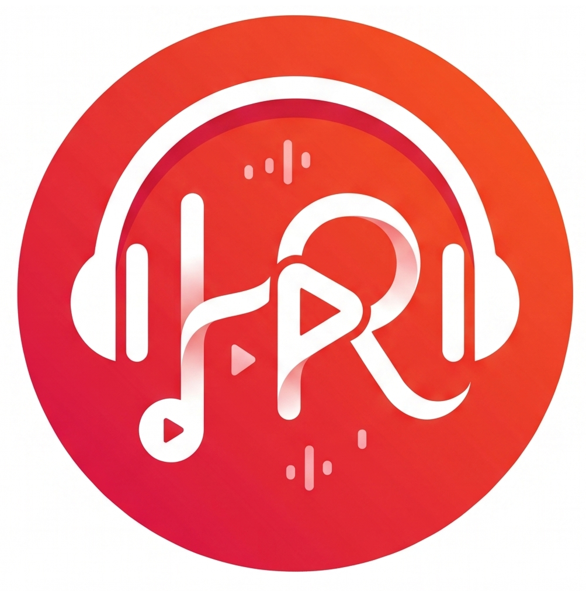
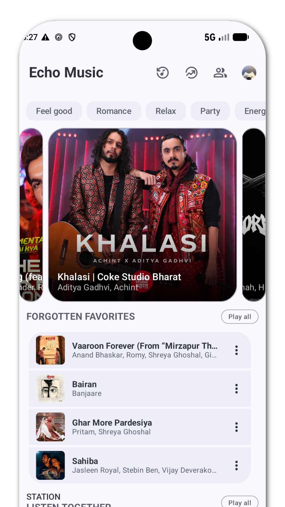
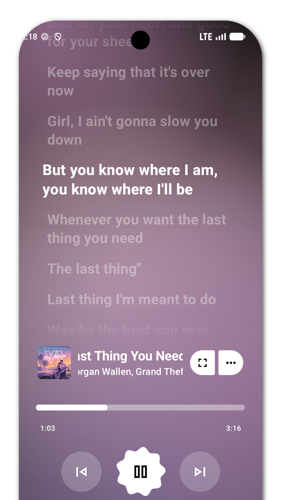
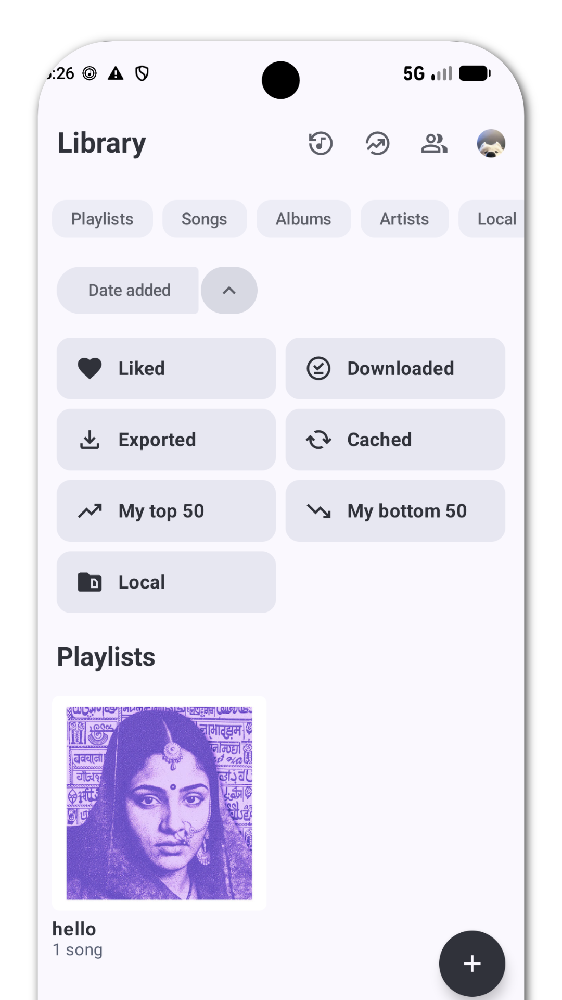

<div align="center">
  

  <p><b>A modern Android music app with ad-free streaming, synced lyrics, offline playback, and an intuitive user experience.</b></p>
</div>

---

## Overview

HR Music is an Android music player based on the GPL-3.0 [Echo Music project](https://github.com/EchoMusicApp/Echo-Music). It includes offline playback, synchronized lyrics, music recognition, and guided setup for self-hosted audio extensions.

Official HR Music release builds check and download new versions from this project’s GitHub Releases in **Settings → App Updates**. Android asks for approval before installing an update.

---

## Table of Contents

- [Overview](#overview)
- [Screenshots](#screenshots)
- [Features](#features)
- [320 kbps Audio Extension](#320-kbps-audio-extension)
- [Lossless Audio Extension](#lossless-audio-extension)
- [Installation & Setup](#installation--setup)
- [Special Thanks](#special-thanks)

---

## Screenshots

<div align="left">
  <table style="margin: 0 auto; border-collapse: collapse;">
    <tr>
      <td align="center" style="padding: 15px; border: none;">
        <b>Home Screen</b><br><br>
        
      </td>
      <td align="center" style="padding: 15px; border: none;">
        <b>Material Player</b><br><br>
        
      </td>
      <td align="center" style="padding: 15px; border: none;">
        <b>Apple Style Player</b><br><br>
        
      </td>
    </tr>
    <tr>
      <td align="center" style="padding: 15px; border: none;">
        <b>Synchronized Lyrics</b><br><br>
        
      </td>
      <td align="center" style="padding: 15px; border: none;">
        <b>Search & Explore</b><br><br>
        
      </td>
      <td align="center" style="padding: 15px; border: none;">
        <b>Music Library</b><br><br>
        
      </td>
    </tr>
  </table>
</div>

---

## Features

### What's New

> **Music DNA (New!)** — Instantly uncover the backstory of any track. Echo Music queries Genius for deep track annotations, and intelligently falls back to Wikipedia API extracts for regional or obscure tracks where crowd-sourced meanings are missing.

<br>

<details>
<summary><b>Streaming & Playback</b></summary>
<br>

- **Ad-Free** — Stream without any interruptions.
- **Lossless & Hi-Res Audio Streaming** — Stream uncompressed studio-quality FLAC/ALAC up to 24-bit/192kHz with the [lossless-extension](https://github.com/EchoMusicApp/lossless-extension).
- **High-Quality 320 kbps Streaming** — Stream crystal-clear 320 kbps audio with the [320kbs-extension](https://github.com/EchoMusicApp/320kbs-extension).
- **Data Saver Mode** — Reduce data consumption when streaming on cellular networks.
- **Seamless Playback** — Switch effortlessly between audio-only and video modes.
- **Background Playback** — Listen while using other apps or with the screen off.
- **Offline Mode** — Download tracks, albums, and playlists via a dedicated download manager.
- **Crossfade** — Smooth transitions between tracks.
- **Canvas Animations** — Visual animations while playing music.

</details>

<details>
<summary><b>Discovery & Echo Find</b></summary>
<br>

- **Echo Find** — Identify songs playing around you using advanced audio recognition.
- **Echo Brain** — An intelligent, on-device engine that analyzes your listening momentum and auto-injects perfectly aligned tracks into your queue.
- **Smart Recommendations** — Personalized suggestions based on your listening history.
- **Comprehensive Browsing** — Explore Charts, Podcasts, Moods, and Genres.

</details>

<details>
<summary><b>Lyrics</b></summary>
<br>

- **Multiple Lyric Animations** — Choose from various lyric display styles.
- **Word-by-Word Lyrics** — Precise per-word synchronization.
- **Lyrics+** — New lyrics provider for improved accuracy and coverage.
- **AI Translation** — Built-in Google Translate integration for lyrics in any language.

  For AI lyrics translation, select **API Route** in the AI settings, enter your [API key](https://www.api-route.com/api-keys), and choose a model available to that key. The preset uses `https://global.api-route.com/v1/chat/completions` with `claude-fable-5-1`; you can enter another exact model ID from the authenticated `/v1/models` catalog using the custom model option. Model availability depends on your key's group and permissions. See the [quickstart](https://www.api-route.com/docs/quickstart).

</details>

<details>
<summary><b>Integrations</b></summary>
<br>

- **Music Sharing via Odesli** — Share songs as Song.link for cross-platform listening.
- **Set as Ringtone** — Directly set any song as your device ringtone.

</details>

<details>
<summary><b>Smart Playback</b></summary>
<br>

- **Pause on Mute** — Auto-pause when your device is muted.
- **Resume on Bluetooth** — Playback resumes when headphones or earbuds reconnect.

</details>

<details>
<summary><b>Customization</b></summary>
<br>

- **UI Density Scale** — Adjust interface spacing to your preference.
- **High Refresh Rate Support** — Smoother UI and animations on supported displays.
- **Fluid UI & Animations** — Material 3 Emphasized easing and GPU-accelerated lyrics for a silky smooth, lag-free experience.
- **Hide Player Thumbnail** — Keep the player minimal without album art.
- **Crop Album Art** — Adjust album art display to fit your style.
- **Hide Video Songs** — Filter out video content from your feed.
- **Hide YouTube Shorts** — Keep Shorts out of your music browsing.

</details>

---

## 320 kbps Audio Extension

1. In HR Music, open **Extensions** from your profile and tap **320 kbps audio**.
2. Sign in with Cloudflare, connect your Git provider if prompted, and confirm the Worker deployment. [Saavn extension source](https://github.com/EchoMusicApp/320kbs-extension)
3. Open the deployed Worker site. Use your browser’s **Share** action, select **HR Music**, and tap **Connect**.

**Prefer Extension Audio** lets the app use matching extension tracks before YouTube Music. Actual quality depends on the tracks available from the source.

---

## Lossless Audio Extension

1. Open **Extensions** in HR Music and tap **Lossless audio**. Copy the private deployment key and tap **Open Vercel**.
2. Sign in with Vercel, connect your Git provider if prompted, and paste the key into the `QOBUZ_ID_SECRET` field. Confirm deployment. [Lossless extension source](https://github.com/EchoMusicApp/lossless-extension)
3. Use the **HR Music** return option if offered. Otherwise open the deployed project site and share it to **HR Music**. Tap **Connect**.

The full player displays the source format and quality when available. **Add Custom Server** supports setups on other domains.

### Vercel return link for maintainers

Set `HR_MUSIC_VERCEL_CALLBACK_HOST` in `local.properties` or as a Gradle project property to a domain you control. Host the return page at `/extensions/vercel` and publish `/.well-known/assetlinks.json` for the app’s application ID and APK signing certificate. Android can then open the Vercel deployment result directly in HR Music. [Vercel deployment callbacks](https://vercel.com/docs/deploy-button/callback) · [Android App Links setup](https://developer.android.com/training/app-links/configure-assetlinks)

---

## Installation & Setup

### Android Installation

For the first installation, open **Releases** on this HR Music repository and download the signed **HR-Music-Universal-GMS** APK. Future updates are available inside the app. [Maintain and publish HR Music releases](SETUP.md#publish-hr-music-on-github).

<details>
<summary><b>Building from Source</b></summary>
<br>

1. **Clone the Repository**

   ```bash
   git clone https://github.com/OWNER/REPOSITORY.git
   cd REPOSITORY
   ```

2. **Configure Android SDK**
   Create a `local.properties` file:

   ```bash
   echo "sdk.dir=/path/to/your/android/sdk" > local.properties
   ```

   _(For detailed paths on Windows/macOS/Linux, refer to [SETUP.md](SETUP.md))_

3. **Firebase Configuration (Optional)**
   Firebase is required for analytics and crash reporting. See the instructions in [SETUP.md](SETUP.md#3-configure-firebase-optional) for adding your `google-services.json`.

4. **Build the Application**
   To build the Universal Debug variant:
   ```bash
   ./gradlew assembleUniversalGmsDebug
   ```

   _(For optimized ARM64 builds, release builds, or other options, refer to [SETUP.md](SETUP.md))_

</details>

---

## Special Thanks

Echo Music stands on the shoulders of several excellent open-source projects. Sincere thanks to:

| Project                                                                                                                   | Description                                         |
| :------------------------------------------------------------------------------------------------------------------------ | :-------------------------------------------------- |
| **[Metrolist](https://github.com/MetrolistGroup/Metrolist)** & **[Vivi Music](https://github.com/vivizzz007/vivi-music)** | Foundational inspiration and architecture reference |
| **[ArchiveTune](https://github.com/koiverse/ArchiveTune)**                                                                | Material You UI inspiration                         |
| **[Better Lyrics](https://better-lyrics.boidu.dev/)**                                                                     | Lyrics enhancement and synchronization              |
| **[SimpMusic](https://github.com/maxrave-dev/SimpMusic)**                                                                 | Lyrics implementation reference                     |
| **[Music Recognizer](https://github.com/aleksey-saenko/MusicRecognizer)**                                                 | Audio recognition (Echo Find)                       |
| **[BravePipe](https://github.com/bravepipeproject/BravePipe)**                                                            | Decryption handling and backup playback engine      |

---

## Legal Disclaimer & Terms of Use

### 1. 100% Free, Open-Source & Strictly Non-Commercial

Echo Music is a fully open-source project (FOSS) created purely for educational purposes and personal use. We do not sell this application, nor do we monetize it in any way. There are no advertisements, no premium features, no subscriptions, and no hidden fees within the app. This project has absolutely no commercial value or financial intent.

### 2. A Custom Browser with Content Filtering

Echo Music acts strictly as a specialized, third-party web browser and client. It simply parses the publicly available website content and APIs of YouTube and YouTube Music, rendering them in a custom user interface. The ad-free experience it provides is fundamentally no different from using a standard web browser (like Chrome, Firefox, or Brave) equipped with a common ad-blocking extension (such as uBlock Origin).

### 3. Support Content Creators

We deeply respect the hard work of artists, musicians, and content creators. We strongly encourage all users to subscribe to [YouTube Premium](https://www.youtube.com/premium). Purchasing a Premium subscription is the best way to financially support the creators you listen to and ensure the continued growth of the platform. Echo Music is built as a proof-of-concept for developers and enthusiasts, not to harm creators' revenues.

### 4. No Hosting of Copyrighted Material

We do not host, upload, distribute, or store any audio, video, or copyrighted media files on our own servers. All content accessed through this application is stored entirely on Google's/YouTube's servers and remains the property of their respective copyright owners. The app merely acts as a conduit to stream publicly accessible links.

### 5. User Responsibility

The software is provided "AS IS", without warranty of any kind. The developers of Echo Music do not encourage or condone piracy. Users are solely responsible for ensuring their usage of this app complies with their local copyright laws and the Terms of Service of the platforms they access.

---

<div align="center">
  <p>Licensed under <a href="LICENSE">GPL-3.0</a></p>
</div>
